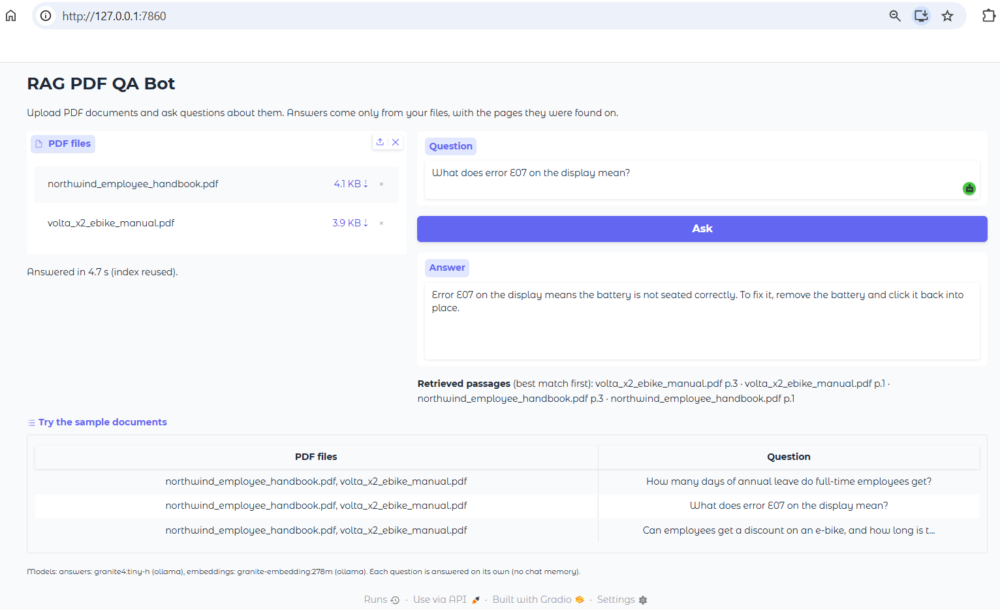
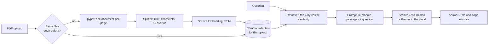

# RAG PDF QA Bot: ask questions about your PDFs


[](https://rag-pdf-qabot.onrender.com)

> Based on IBM's **"Construct a QA Bot that Leverages LangChain and LLMs to Answer
> Questions from Loaded Documents"** project (IBM Skills Network, *Develop Generative
> AI Applications* series on Coursera), rebuilt to run **locally and free** on IBM
> Granite via Ollama, extended to several documents with cached indexes, and
> **deployed** as a public demo.

Upload up to 5 PDFs, ask a question, and get a short answer taken only from your
documents, with the pages it was found on. If the answer isn't in the files, the
bot says so instead of guessing.

**▶ [Try the live demo](https://rag-pdf-qabot.onrender.com)** (free hosting: the first visit after a quiet period takes about a minute while the server wakes up)



## What this project covers

| Project section | Where it's implemented |
|---|---|
| LLM | `src/qabot/llm.py` (`get_llm`), checked by `scripts/00_check_setup.py` |
| PDF document loader | `src/qabot/ingest.py` (`read_pdf`, `load_pdfs`) |
| Text splitter | `src/qabot/ingest.py` (`split_documents`), `scripts/01_load_and_split.py` |
| Embedding model | `src/qabot/llm.py` (`get_embeddings`) |
| Vector store and retriever | `src/qabot/vectorstore.py`, `scripts/02_retrieve.py` |
| Question-answering chain | `src/qabot/qa.py`, `scripts/03_ask_pdf.py` |
| Gradio interface | `src/qabot/ui.py`, `app.py` |
| **Extension 1:** index each document set once, reuse it | `src/qabot/index.py` |
| **Extension 2:** live deployment with a provider switch | `render.yaml`, `.github/workflows/deploy.yml` |
| Tests and CI | `tests/` (46 tests, fake models), `.github/workflows/tests.yml` |

## What's different from the original project

**Changed to run locally and for free**
- IBM watsonx.ai (Mistral Medium + Granite Embedding) → **Ollama** running IBM Granite 4 and the **same Granite Embedding 278M model**, on a consumer GPU.
- Pinned 2024 libraries (LangChain 0.2, Gradio 4.44, Chroma 0.4) → current versions (LangChain 1.x, Gradio 6), managed with `uv`.
- `RetrievalQA` (now a legacy chain in `langchain-classic`) → the same retrieve-then-answer steps as an LCEL pipeline. The lab's chain is still run side by side in `03_ask_pdf.py --compare-lab`.
- `PyPDFLoader` comes from `langchain-community`, which LangChain is sunsetting, and has no standalone package yet. It's a thin wrapper around `pypdf`, so the loader calls `pypdf` directly; the page text is identical on the sample files.

**Bugs in the original code, fixed and covered by tests**
- **Uploads leak into each other.** `Chroma.from_documents(chunks, embedding_model)` without a collection name adds every upload to one shared in-memory collection, so chunks from an earlier PDF can be retrieved for questions about the next one. `test_lab_code_mixes_uploads` reproduces it; here each upload gets its own collection.
- **Only 3 tokens per chunk are embedded.** The lab sets `TRUNCATE_INPUT_TOKENS: 3`, so retrieval compares just the first three tokens of each chunk. Whole chunks are embedded here.
- **The PDF is re-processed for every question.** Loading, splitting and embedding run again on each click. Fixed by extension 1.
- **Large or scanned PDFs fail silently or crash.** Uploads are now checked first (PDF only, at most 5 files and 20 MB, extractable text) with a clear message.
- **`share=True` opens a public tunnel** to your models. Locally the app stays on your computer; the public version is a deliberate deployment.

**Improvements**
- **Several PDFs at once**, with each answer listing the file and page of the retrieved passages.
- **Grounded answers:** the prompt allows only the documents as a source and gives a fixed reply when the answer isn't there; no sources are shown for that reply.
- **Cosine similarity:** Chroma ranks by Euclidean distance unless told otherwise; collections use cosine similarity, the usual measure for text embeddings (`test_ranks_by_direction_not_length`).
- **Errors become messages:** a bad file, an empty question, Ollama not running or a Gemini rate limit are shown in the page, never as a crash.

## How it works



**Index cache (extension 1).** Each upload is identified by a SHA-256 fingerprint of the files' *contents*, so the same files in any order or under another name reuse the stored index, while any changed or added file builds a new one. Only the 3 most recently used indexes are kept, and an evicted index's vectors are deleted, so memory stays bounded on a shared server.

**Provider switch (extension 2).** Two settings in `.env` choose where the models run, with no code changes:

| Setup | `LLM_PROVIDER` | `EMBEDDINGS_PROVIDER` | Used for |
|---|---|---|---|
| Local (default) | `ollama`: Granite 4 | `ollama`: Granite Embedding 278M | Development, private documents, no internet |
| Local without Ollama | `gemini` | `huggingface`: the same Granite Embedding on CPU | Machines without a GPU |
| Cloud | `gemini`: Gemini Flash (free tier) | `gemini`: Gemini Embedding 2, 768 dimensions | The public demo on Render |

**Deployment.** The demo runs on Render's free web service, described in `render.yaml`. Its 512 MB of memory can't hold PyTorch plus an embedding model, so the cloud setup uses Gemini for embeddings too; the whole app then peaks at about 270 MB (measured with the server's exact packages). Render installs the locked versions with `uv sync --locked --no-dev --extra gemini`, so the demo runs the same versions the tests did. Pushing a version tag runs the tests, then calls Render's deploy hook with the tested commit. The Gemini key is set in Render's dashboard and never appears in the repository.

## Project structure

```
rag-pdf-qabot/
├── src/qabot/
│   ├── config.py        # settings from .env: providers and models
│   ├── llm.py           # answer and embedding models (replaces WatsonxLLM / WatsonxEmbeddings)
│   ├── ingest.py        # upload checks, PDF loading, text splitting
│   ├── vectorstore.py   # one Chroma collection per upload, cosine similarity, retriever
│   ├── qa.py            # grounded prompt and LCEL question-answering chain
│   ├── index.py         # index cache (extension 1) and the QABot class
│   ├── ui.py            # Gradio page and its handlers
│   └── paths.py
├── scripts/             # one script per project section (00–03), plus the sample-PDF builder
├── data/samples/        # two fictional PDFs written for this repo
├── tests/               # 46 tests with fake models: no Ollama, GPU or API key needed
├── app.py               # starts the web app (locally and on Render)
├── render.yaml          # the live demo's hosting settings (extension 2)
└── pyproject.toml       # dependencies, managed with uv
```

## Quick start (local)

**Requirements:** [Ollama](https://ollama.com) and [uv](https://docs.astral.sh/uv/). Tested on Windows 11 with a GTX 1660 Ti (6 GB) and 16 GB RAM.

```bash
# 1. Download the models (once, about 4.5 GB)
ollama pull granite4:tiny-h
ollama pull granite-embedding:278m

# 2. Get the code and install dependencies
git clone https://github.com/hlmhlr/rag-pdf-qabot.git
cd rag-pdf-qabot
uv sync

# 3. Check the models work
uv run python scripts/00_check_setup.py

# 4. Start the app and open http://127.0.0.1:7860
uv run python app.py
```

### Run each step on its own

```bash
uv run python scripts/01_load_and_split.py      # pages and chunks
uv run python scripts/02_retrieve.py            # which passages match each question
uv run python scripts/03_ask_pdf.py             # full answers, with timing
uv run python scripts/03_ask_pdf.py --compare-lab
uv run python scripts/03_ask_pdf.py --pdf my.pdf --question "..."
```

### Cloud setup (optional)

```bash
uv sync --extra gemini    # Gemini for answers and embeddings, as in the demo
uv sync --extra cloud     # or: Gemini plus Granite Embedding on CPU (adds PyTorch)
cp .env.example .env      # Windows PowerShell: copy .env.example .env
```

Then set `LLM_PROVIDER=gemini`, `EMBEDDINGS_PROVIDER=gemini` (or `huggingface`) and `GOOGLE_API_KEY` (free key from [Google AI Studio](https://aistudio.google.com/apikey)) in `.env`.

### Tests

```bash
uv run pytest
```

### Deploy your own copy

1. On [Render](https://render.com) (free, no card), choose **New > Blueprint**, connect your fork, and enter your `GOOGLE_API_KEY` when asked. Render creates the service from `render.yaml`.
2. Copy the service's deploy hook (*Settings > Deploy Hook*) into a GitHub Actions secret named `RENDER_DEPLOY_HOOK_URL`.
3. Push a tag: `git tag v0.2.0 && git push origin v0.2.0`. The tests run, then Render deploys that commit.

## Results

On the two sample documents (an employee handbook and an e-bike manual, 3 pages each), local setup, GTX 1660 Ti:

| Question | Answer | Correct |
|---|---|---|
| How many days of annual leave do full-time employees get? | 26 days of paid annual leave per year | ✅ |
| How long does a full battery charge take? | About 4.5 hours; 20–80% in about 2 hours | ✅ |
| What does error E07 on the display mean? | Battery not seated correctly; remove and refit it | ✅ |
| Employee e-bike discount, and battery warranty? | 40% discount over 24 months; 2 years or 800 cycles | ✅ (combines **both files**) |
| Who is the CEO of Northwind Cycles? | "I couldn't find the answer in the uploaded documents." | ✅ (no guess, no sources) |

**Speed (local):** the first question took 27 s, which includes Ollama loading both models onto the GPU and embedding the files. Later questions reuse the index and take **about 2.5 s**.

**Without Ollama** (`huggingface` embeddings): the Granite embedding model downloads once (556 MB) and then loads in about 30 s on CPU when the app starts; Gemini answers in a few seconds.

**Demo setup** (Gemini for both models): peak memory of about 270 MB for the running app with the samples indexed, measured with the exact packages Render installs, within the free plan's 512 MB.

## Limitations

- **Sources are the retrieved passages**, not a proof of what the model used: every found answer lists the top 4 passages, so less relevant pages can appear next to the right one. Reliable per-sentence citations would need a larger model.
- **No chat memory:** each question is answered on its own, as in the original project.
- **PDFs with a text layer only.** Scanned PDFs are refused with a message; they would need OCR first. Tables and multi-column layouts may come out of `pypdf` in the wrong reading order.
- **Small local model:** Granite 4 Tiny (about 1B active parameters) is fast on a 6 GB GPU but follows instructions less reliably than large cloud models.
- **The public demo is shared:** one free Gemini quota and a tenth of a CPU serve every visitor, so it can be slow or rate-limited, and indexes are kept only in memory (lost when the server sleeps or restarts). Don't upload confidential documents to the demo; run it locally for those.
- **The demo's retrieval differs from local runs:** it uses Gemini Embedding instead of Granite Embedding to fit in 512 MB, so the passages it finds can differ slightly from the results above.
- **Small evaluation:** results come from 5 questions on 2 short documents written for this repo, not a benchmark.

## What I learned

- A RAG system is a pipeline of small, separately testable steps: loading, splitting, embedding, storing, retrieving and generating. Testing each step with a fake model makes problems visible before an LLM can hide them.
- Old example code can have silent bugs: a shared default collection mixed uploads, a truncation setting embedded 3 tokens per chunk, and the vector store used a distance measure that doesn't suit text embeddings. None of them crashed; I found them by writing tests that check the results.
- Caching by a content hash is a simple, reliable way to avoid repeating expensive work, and an LRU limit keeps the cache safe on a shared server.
- Telling the model to answer only from the context, with an exact fallback sentence, makes "not in the documents" detectable in code.
- Libraries move fast: LangChain moved `RetrievalQA` to a legacy package and is sunsetting `langchain-community`, so I checked deprecation warnings and replaced dependencies I couldn't rely on.
- Hosting terms change: my first target, free Hugging Face Gradio Spaces, became a paid feature during the project. Measuring the app's real memory use let me move to a 512 MB free host with confidence instead of guessing.
- Deployment is part of the product: a provider switch keeps one codebase for local and cloud use, secrets belong in the platform's secret store, and deploying only from tested release tags keeps the demo working.

## Acknowledgments and references

- Original project: **"Construct a QA Bot that Leverages LangChain and LLMs to Answer Questions from Loaded Documents"** by Kang Wang, Wojciech "Victor" Fulmyk, Kunal Makwana and Ricky Shi, with Hailey Quach, IBM Skills Network, part of the *Develop Generative AI Applications* series on Coursera. The lab content is licensed under Apache 2.0. This repository is an independent re-implementation; the sample documents and all examples were written for it.
- [IBM Granite 4](https://www.ibm.com/granite/docs/models/granite) and [Granite Embedding 278M multilingual](https://huggingface.co/ibm-granite/granite-embedding-278m-multilingual), both Apache 2.0.
- [Google Gemini API](https://ai.google.dev/) for the cloud setup, under Google's terms; free-tier requests may be used by Google to improve its products.
- [LangChain](https://docs.langchain.com/), [Chroma](https://www.trychroma.com/), [Gradio](https://www.gradio.app/), [pypdf](https://github.com/py-pdf/pypdf), [Ollama](https://ollama.com), [Render](https://render.com), [uv](https://docs.astral.sh/uv/).
- Lewis et al. (2020), [*Retrieval-Augmented Generation for Knowledge-Intensive NLP Tasks*](https://arxiv.org/abs/2005.11401).

## License

MIT, see [LICENSE](LICENSE). Applies to the code in this repository only; the models keep their own licenses.
